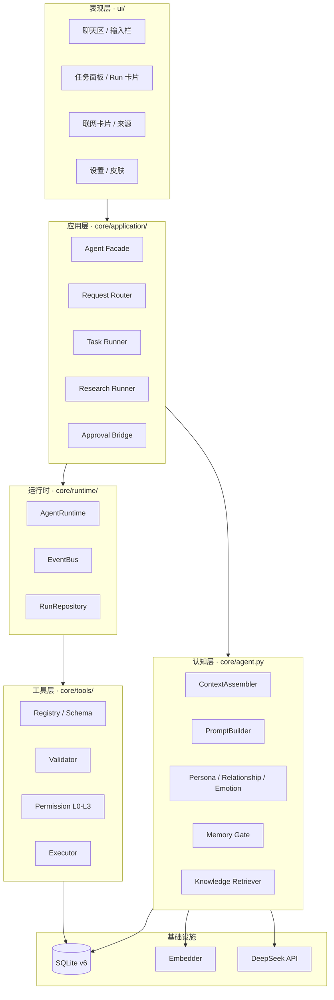
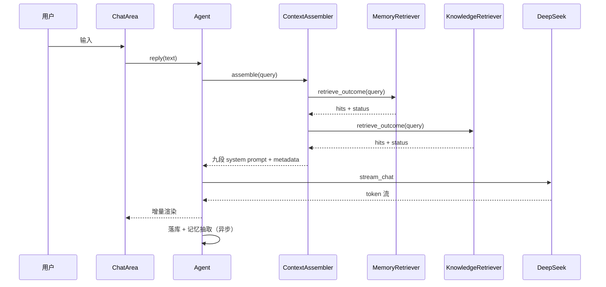
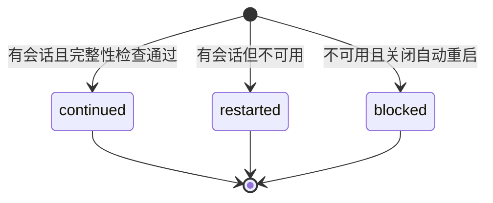

# Amiya Agent · 本地桌面陪伴智能体


> 一个跑在本机的桌面陪伴智能体：有稳定人格、长期记忆、能被审批的行动能力，
> 以及**可被评测、可被观测**的检索系统。
> 它不追求"功能数量"，追求的是**做的事情值得信任**。

> **本仓库状态**：已包含 2.x 的后端架构层（Runtime / Tool System / Tasks / Skills /
> Scheduler / 联网研究 / 检索状态 / 协议校验）。界面仍是早期版本，任务面板、联网卡片、
> 检索状态展示等 UI 尚未接入——这些**已明确列为技术债**（见 §16.1），不是"已完成"。
> 完整的界面版本在作者本地仓库中开发，接入后同步到这里。

---

## 目录

- [1. 这个项目是什么](#1-这个项目是什么)
- [2. 设计原则](#2-设计原则)
- [3. 系统全景](#3-系统全景)
- [4. 一次对话的生命周期](#4-一次对话的生命周期)
- [5. 行动系统](#5-行动系统)
- [6. 联网与研究会话](#6-联网与研究会话)
- [7. 记忆系统](#7-记忆系统)
- [8. 知识 RAG](#8-知识-rag)
- [9. 上下文组装](#9-上下文组装)
- [10. 可观测性](#10-可观测性让坏了能被看见)
- [11. 数据与迁移](#11-数据与迁移)
- [12. 工程实践](#12-工程实践)
- [13. 失败矩阵](#13-失败矩阵)
- [14. 配置](#14-配置)
- [15. 目录结构](#15-目录结构)
- [16. 技术债与路线图](#16-技术债与路线图)
- [17. 运行](#17-运行)

---

## 1. 这个项目是什么

一个**本地优先**的个人 Agent。它把三类信息严格分开：

| 层 | 存什么 | 谁写 | 会不会消失 |
|---|---|---|---|
| **Persona（人格）** | 身份、价值观、说话方式、关系阶段 | 配置文件，人工维护 | 永不自动改写 |
| **Knowledge（知识）** | 世界观设定、项目文档 | 静态语料 | 不随对话变化 |
| **Memory（记忆）** | 关于用户的经历、偏好、事实 | 对话中抽取 + 人工确认 | 受衰减与闸门约束 |

在此之上，它还能**做事**：建任务、定时提醒、联网检索、调用技能——每一步都在权限与审批之下。

### 它不是什么

- **不是"接个大模型就能聊天"的壳**：模型只负责生成与决策，执行、状态、权限全在本地代码里。
- **不是向量数据库 demo**：检索有评测集、有阈值校准、有降级状态，`docs/2x/IMPL_19`–`IMPL_21` 有完整数据。
- **不是全自动 Agent**：任务要审批、外部内容不入长期记忆、人格核心不可被模型改写。

---

## 2. 设计原则

1. **人格 / 知识 / 记忆三柱分离。** 三者各有存储、检索与生命周期，**绝不混表、绝不互相写入**。
   混在一起是陪伴型 Agent 最常见的失败模式：模型会把"设定"当成"事实"，或把"记忆"说成"知识"。
2. **Agent 是编排器，不是执行者。** 模型提出行动，Runtime 校验、授权、执行、观察。
   模型**不能**因为"自己说搜索成功了"就认为搜索真的成功——必须有真实 Observation。
3. **安静地降级是最危险的失败模式。** "没检索到"与"检索坏了"必须可区分；
   凡是降级路径，都要有可见信号（状态、日志、UI 标注）。
4. **默认关闭、可回滚。** 每个新能力都有独立开关，默认不改变既有行为；上线前用评测决定是否开启。
5. **本地优先，不是本地大模型。** 对话、记忆、检索都在本机；只有生成调用远程 API。
6. **用数据裁决，不用感觉裁决。** 阈值、混合检索、reranker 是否上，都先出分布与对照实验。

---

## 3. 系统全景

### 3.1 分层



**依赖方向是单向的**：`ui → application → agent/runtime → tools → storage`。
反向依赖一律不允许（`core/tools` 不知道 UI 存在，`runtime` 不 import `ui`）。

### 3.2 两条路径

系统有两条**刻意分开**的路径：

| | 快路径（聊天） | 任务路径（行动） |
|---|---|---|
| 入口 | 直接输入 | ⚡ 任务模式 |
| 调用 | 流式 `stream_chat` / 带工具 `chat_with_tools` | Runtime 状态机 |
| 工具 | 只读工具（时间/计算/记忆查询） | 读写工具（建任务、提醒），需审批 |
| 状态 | 无持久 Run | `agent_run` + `agent_run_step` |
| 失败 | 降级为纯文本回答 | 状态机进入 failed，事件可追溯 |

分开的原因：陪聊要低延迟、不能因为"审批弹窗"卡住；行动要可审计、可取消、可回滚。
把两者混成一条链，最后一定会在某个地方互相拖累。

---

## 4. 一次对话的生命周期

### 4.1 快路径



关键点：

- **检索先于生成**，但检索失败不阻断生成（降级为空块 + 状态标记）。
- **提示词九段顺序固定**：身份 → 关系 → 行为 → 情绪 → 记忆 → 知识 → 技能 → 时间 → 输出约束。
  顺序有测试锁死（`test_system_prompt_byte_equivalent`），改动会立刻被发现。
- **分数绝不进提示词**：记忆/知识只给正文与出处，不给相似度——防注入，也防模型"照着分数编"。

### 4.2 任务路径

```
用户目标
  → Router 判定（聊天 / 任务 / 联网）
  → AgentRuntime.start()
  → 模型决定：直接答 / 调工具
  → Validator 校验参数
  → Permission 判定（L0/L1 放行，L2 审批，L3 拒绝）
  → Executor 执行
  → Observation 回填
  → 循环直到完成 / 失败 / 取消
```

每一步都写 `agent_run_step`——**"模型可见 ⟺ 已记录"**。事后可以完整复盘一次任务里
模型看到了什么、做了什么、拿到了什么。

---

## 5. 行动系统

### 5.1 工具协议

```python
@dataclass(frozen=True)
class ToolSpec:
    name: str
    description: str
    parameters: dict          # JSON Schema
    permission: PermissionLevel
    handler: Callable
```

四道关：**Schema 校验 → 参数校验 → 权限判定 → 执行**。
任何一道失败都返回结构化错误，不抛异常给模型——模型需要看到"为什么失败"才能改正。

### 5.2 权限分级

| 级别 | 含义 | 行为 |
|---|---|---|
| L0 | 纯读、无副作用（时间、计算） | 直接放行 |
| L1 | 白名单内的低风险写 | 注册即授权 |
| L2 | 有副作用（建任务、改提醒） | **必须审批**，fail-closed |
| L3 | 高危（删除、外部写） | 首版一律拒绝 |

"fail-closed" 的意思是：**没有审批器时，L2 默认拒绝**，而不是默认放行。
这条在 `permissions.py` 里是一行显式判断，不依赖调用方记得传审批器。

### 5.3 任务与提醒

- `assistant_task`：标题、描述、到期时间、优先级、状态、`notified_at`。
- 到期提醒用 `notified_at` 做**至多一次**投递（at-most-once）：领到就写，重启不会重复打扰。
- 取消是**状态变更**，不是物理删除——审计需要。

---

## 6. 联网与研究会话

### 6.1 服务端工具的两条硬约束（实测，不是文档）

| 约束 | 证据 |
|---|---|
| 带服务端工具的请求，**首条非 system 消息必须是 user** | 同样非法序列：普通请求 200，带工具 400 |
| 页面正文不在 `data` 里，加密在 `signature` 中 | `data` 恒为空串；不回传则页面丢失 |

第一条由 `Agent._window()` 归一化 + `core/protocol_guard.py` 兜底；
第二条由**研究会话**解决。

### 6.2 研究会话（schema v6）



- `continued`：消息序列 = `[user(上轮), assistant(含 server_tool_calls), user(本轮)]`。
- `restarted`：不塞无协议历史，重新检索，卡片标注"已重新检索"。
- `blocked`：不发起请求，提示用户重新提问（仅 `RESEARCH_SESSION_AUTO_RESTART=0`）。

**为什么值得一张表**：实测发现，丢 `signature` 不会让答案变错，而是让模型**静默重搜**——
成本翻倍、来源可能漂移，用户完全看不出来。这比报错危险。

---

## 7. 记忆系统

### 7.1 五通道打分

```
score = 0.40·vector + 0.20·keyword + 0.15·recency + 0.15·importance + 0.10·confidence
```

| 通道 | 解决什么 |
|---|---|
| vector | 语义相近（"准备考试" ↔ "复习"） |
| keyword | 专名、项目名（小模型最容易糊掉的部分） |
| recency | 最近发生的事自然浮上来 |
| importance | 重要事实优先被想起 |
| confidence | 用户确认过的更可信 |

### 7.2 相关性闸门（关键修复）

**问题**：`recency / importance / confidence` 是"记忆自身的属性"，不是"与问题的相关性"。
它们会给每条记忆垫底分，导致 `top_k` **永远被填满**——问"明天湛江天气"，返回 5 条无关记忆，
第一条是"21 岁生日"。

**数据**（23 条真实提问，`docs/2x/lab/calibrate_memory.py`）：

| 名次 | 最低分 | 中位 |
|---|---|---|
| 第 1 名 | 0.429 | 0.472 |
| 第 8 名 | 0.300 | 0.339 |

所有名次都 ≥0.30，`min_score=0.05` 从未过滤任何东西。

**修法**：证据闸门——`vector ≥ 0.50` 或 `keyword ≥ 0.20` 才进入候选；先验只参与排序。

**效果**：命中数 184 → 63，无关查询 0 条，相关查询仍 4–5 条。

### 7.3 写入闸门

不是每句话都值得记。抽取引擎输出候选后，经过：

1. 类型判定（fact / preference / event / relationship）；
2. 去重（同类型 + 相似内容合并，提升 confidence）；
3. 黑名单（用户明确不让记的内容，检索层还有第二道拦截）；
4. 重要性阈值（低于阈值只留在对话里，不进长期记忆）。

---

## 8. 知识 RAG

### 8.1 语料与切块

- 语料：`knowledge/*.md`（角色设定）+ 可选 `docs/2x`（项目文档，`KNOWLEDGE_EXTRA_DIRS`）。
- 切块：按 Markdown 标题边界，一块 = 一个标题到下一个标题；chunk id 稳定（`文件::序号`）。
- 出处随块走：命中时提示词里带 `（来源 › 标题）`，方便人工校订。

### 8.2 检索：默认向量，混合可选

| 模式 | 说明 |
|---|---|
| `hybrid=0`（默认） | 向量余弦 + 朴素关键词加权 |
| `hybrid=1` | 向量 + BM25 双路召回，RRF 融合（需要 `rank_bm25`） |

**混合检索的评测结论是"暂不启用"**（诚实记录）：

| 系统 | R@5 | R@10 | MRR | nDCG@10 |
|---|---|---|---|---|
| dense | 0.750 | 0.750 | **0.646** | **0.672** |
| hybrid | 0.750 | 0.792 | 0.624 | 0.665 |
| BM25-only | 0.667 | 0.667 | 0.548 | 0.576 |

R@10 +4.2pp，但排序略降；在 24 条查询、152 块语料上属噪声范围。
原因：本机装不上 jieba（退化为字符二元组）、语料同主题重复、BM25 在小语料 IDF 退化。
代码保留 jieba 分支，装上即生效。

### 8.3 知识侧为什么没有闸门

用同法校准后发现**不可分**：正例 top-1 最低 0.363，负例最高 0.590，间隔 −0.227；
规则网格把向量门槛抬到 0.75，负例仍有 4/8 被收进来。

原因：语料全是同一项目的文档，"技术相关"的话天然接近；而余弦衡量的是"话题接近"，
不是"能否回答"。结论：**知识侧要提升精度，得靠 cross-encoder（reranker），而不是继续调阈值**。
详见 `docs/2x/KNOWLEDGE_RETRIEVAL_CALIBRATION.md`。

---

## 9. 上下文组装

`ContextAssembler` 是认知系统的**唯一出口**，只做组装：不调工具、不请求模型、不碰 UI。

九段提示词（顺序由测试锁死）：

```
① 身份      ② 关系      ③ 行为准则
④ 情绪      ⑤ 记忆块    ⑥ 知识块
⑦ 技能目录  ⑧ 当前时间  ⑨ 输出约束
```

设计要点：

- **Persona 固定注入，不参与检索排序**——人格不能被"相关性"决定。
- 记忆与知识分别成块，**互不混入**（`【相关用户记忆】` / `【角色知识】`）。
- 块内只给正文与出处，**不给分数**。

---

## 10. 可观测性：让"坏了"能被看见

历史上最严重的一次故障：`sentence-transformers` 因依赖漂移无法导入，
`_embed_all()` 捕获异常返回 `[]` → 知识检索**恒为空**，记忆向量通道降级。
界面上只是"没有参考"，潜伏了数天。

现在有两层防线：

### 10.1 启动探针

`embedder.probe()` 真的跑一次 `encode`（不是"包能不能 import"），失败时在聊天区明确提示
"检索不可用"。只提示一次，健康时静默。

### 10.2 四态检索 + Trace

| 状态 | 含义 |
|---|---|
| `SUCCESS` | 正常且有命中 |
| `NO_RELEVANT_RESULTS` | 链路正常，但没内容过门槛（**正常结果**） |
| `DEGRADED` | 部分可用（如嵌入挂了，只剩关键词） |
| `FAILED` | 检索本身出错 |

`RetrievalTrace` 记 `status / hits / candidates / top_score / duration_ms`，
**不记 query 原文、不记正文、不落盘**。`degraded_ratio()` 可以直接回答
"最近是不是经常降级"。

---

## 11. 数据与迁移

单文件 SQLite（WAL），schema 当前 **v6**：

| 版本 | 内容 |
|---|---|
| v1 | conversation / memory / user_profile / persona_state / blacklist |
| v2 | memory_candidate（候选记忆） |
| v3 | 记忆条目扩展字段 |
| v4 | agent_run / agent_run_step / assistant_task |
| v5 | `assistant_task.notified_at`（提醒至多一次） |
| v6 | research_session（研究会话协议状态） |

迁移策略：

- **逐版本推进**，每步单独提交并写 `user_version`——中途失败不会停在"表建了一半但版本已最新"。
- **升级前备份**（仅当库里已有表；空库不产生垃圾备份——这是测试发现的）。
- `tests/test_migration_chain.py` 用**真实 v1 库**验证 v1 → v6：数据行数、关键字段、
  每一版新增的表与列都检查。

---

## 12. 工程实践

| 维度 | 现状 |
|---|---|
| 测试 | **306 passed**（CI 覆盖的后端子集），48 个测试文件，约 8.7k 行 |
| 代码 | 13.2k 行（`core/` + `ui/`） |
| 分层 | 单元 / 集成 / UI 组件 / 协议 / 迁移，五类分开 |
| CI | GitHub Actions：装依赖 → `pip check` → 后端子集（`hashing` 嵌入，不下载模型、不调 API） |
| 评测 | 检索评测、记忆分布校准、协议冒烟，全部可复跑 |
| 文档 | `docs/TECHNICAL_REPORT.md`（技术报告）+ `docs/2x/` 设计与实施记录 |

**一个刻意的取舍**：真实 API 测试**不进 CI**。它花钱、受外部波动影响，进去只会让红绿失去意义；
放在 `docs/2x/lab/protocol/live_smoke.py` 手动跑。

---

## 13. 失败矩阵

| 故障 | 表现 | 系统行为 |
|---|---|---|
| 嵌入模型坏了 | 向量检索为空 | 启动提示 + 四态标 `DEGRADED`，关键词路兜底 |
| 知识库目录缺失 | 无知识块 | 静默关闭知识检索，不影响聊天 |
| 检索超时 | 无参考 | 降级为空块，本轮继续 |
| 联网 400（序列非法） | 请求失败 | 错误分类文案；序列在本地已归一化 |
| 模型不调工具 | 卡片空白 | 卡片明确写"模型未调用搜索"，不假装成功 |
| 工具审批无人处理 | L2 卡住 | fail-closed：直接拒绝，不默认放行 |
| 任务执行中崩溃 | Run 中断 | 状态置 failed，step 可复盘 |
| 会话过期 | 无法延续 | `restarted`，卡片标注"已重新检索" |

---

## 14. 配置

```env
# 模型
DEEPSEEK_API_KEY=sk-...
MODEL=deepseek-chat
DEEPSEEK_THINKING=off          # off=低延迟陪聊

# 能力开关（默认全关，按需打开）
RUNTIME_ENABLED=0              # ⚡ 任务模式
WEB_TOOLS_ENABLED=0            # 🌐 联网
SCHEDULER_ENABLED=0            # ⏰ 到期提醒
SKILLS_ENABLED=0               # 技能目录

# 记忆
MEMORY_TOP_K=5
MEMORY_MIN_VECTOR=0.50         # 相关性闸门（向量）
MEMORY_MIN_KEYWORD=0.20        # 相关性闸门（关键词）

# 知识
KNOWLEDGE_TOP_K=4
KNOWLEDGE_HYBRID=0             # 混合检索（评测无正收益，默认关）
KNOWLEDGE_EXTRA_DIRS=          # 例：docs/2x

# 研究会话
RESEARCH_SESSION_ENABLED=1
RESEARCH_SESSION_TTL_HOURS=24
RESEARCH_SESSION_AUTO_RESTART=1
```

---

## 15. 目录结构

```
core/
├── agent.py              # 编排：检索 → 组装 → 生成 → 落库
├── context.py            # ContextAssembler（九段提示词唯一出口）
├── prompt_builder.py     # 模板与块拼接
├── persona/              # 人格、关系、行为规则
├── emotion.py            # 二维情绪检测与表达
├── memory/               # 存储 / 五通道检索 / 嵌入 / 抽取 / 闸门
├── knowledge/            # 语料加载 / 检索 / BM25 / 管理
├── application/          # Facade / Router / Runner / 审批桥
├── runtime/              # 状态机 / 事件 / Run 仓储
├── tools/                # 协议 / 校验 / 权限 / 执行器 / 内置工具
├── tasks/                # 任务仓储
├── skills/               # SKILL.md 三级加载
├── scheduler.py          # 到期提醒
├── research_session.py   # 研究会话协议状态
├── retrieval_status.py   # 检索四态
├── retrieval_trace.py    # 轻量 trace
└── protocol_guard.py     # 出站消息序列校验

ui/
├── app.py                # 装配根（Composition Root）
└── components/           # 聊天区 / 输入栏 / 卡片 / 面板

docs/                    # 技术报告 + 设计文档
tests/                    # 55 个测试文件
```

---

## 16. 技术债与路线图

明确写出来，不藏。

### 16.1 未完成的界面（本阶段已知技术债）

| 位置 | 现状 | 影响 | 计划 |
|---|---|---|---|
| 检索状态展示 | 后端有 `last_retrieval_status` 与 trace，**界面只显示"参考 N 条"** | 降级时用户看不到"检索坏了" | UI 重做时加状态角标/提示条 |
| 研究会话三态 | 卡片只加文字后缀（"延续/已重新检索"），**没有"重新检索"按钮** | `blocked` 状态无法自助恢复 | 随 UI 重做补交互 |
| 知识库管理 | 无界面，只能改目录与 `.env` | 非技术用户无法维护语料 | 设置页加"知识库"面板 |
| 记忆审阅 | 有后端接口与 Inspector，**无正式页面** | 用户无法直观纠正错误记忆 | 记忆管理页 |
| 任务历史 | 有 `agent_run` 表与复盘数据，**无历史视图** | 只能看当前 Run | 任务详情页 |

### 16.2 其他技术债

1. **研究会话不跨重启续接**：`_active_id` 在内存里；重启后从新会话开始（协议仍在库中，但不自动拾取）。
2. **知识侧没有证据闸门**：校准证明当前信号不可分，需 reranker。
3. **语音只有 TTS 半边**：ASR 适配层未接，全双工未做。
4. **MCP 未接**：工具来源仍是内置注册表；Adapter 设计已完成，未实现。
5. **Files API 未做**：本地文档分析需要先定隐私边界（用户主动选择、只读、不自动入记忆）。
6. **本仓库 UI 落后于后端**：任务面板、联网卡片、检索状态展示均未接入（见 §16.1）。

### 16.3 路线图

| 阶段 | 内容 |
|---|---|
| 近期 | UI 重做（含检索三态展示、记忆审阅、任务历史）、README/架构图同步公开仓库 |
| 中期 | R2 reranker（先离线验证可分性）、ContextCandidate + Query Planner、Files API |
| 长期 | 全双工语音、受控主动性（Standing Intent）、跨来源上下文协调 |

---

## 17. 运行

```bat
python -m venv .venv
.venv\Scripts\activate
pip install -r requirements.txt

copy .env.example .env      :: 填入 DEEPSEEK_API_KEY
python main.py
```

首次启动会在 `data/amiya.db` 建库并迁移到 v6；`knowledge/` 放你的知识库 Markdown。

---

## 许可

MIT。角色与世界观素材版权归原作者所有，仓库内不含语音模型与参考音频。
